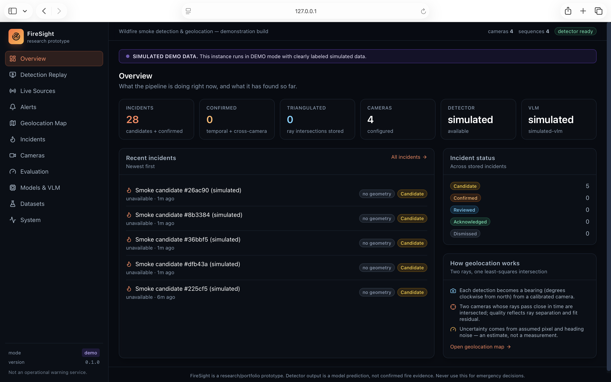
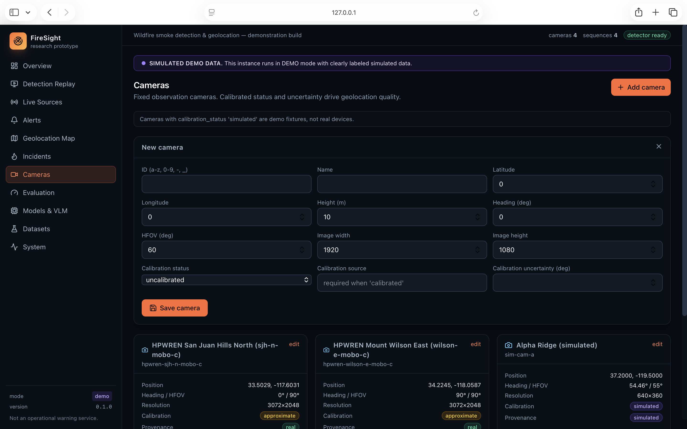
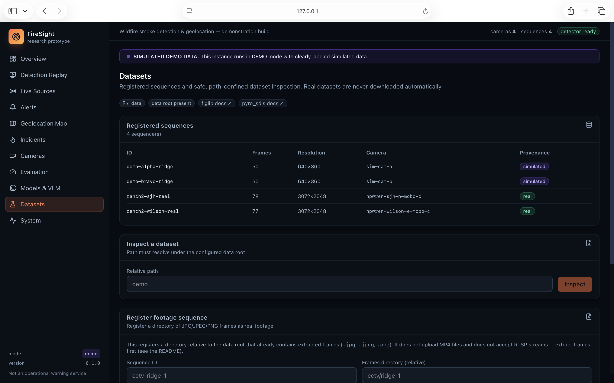
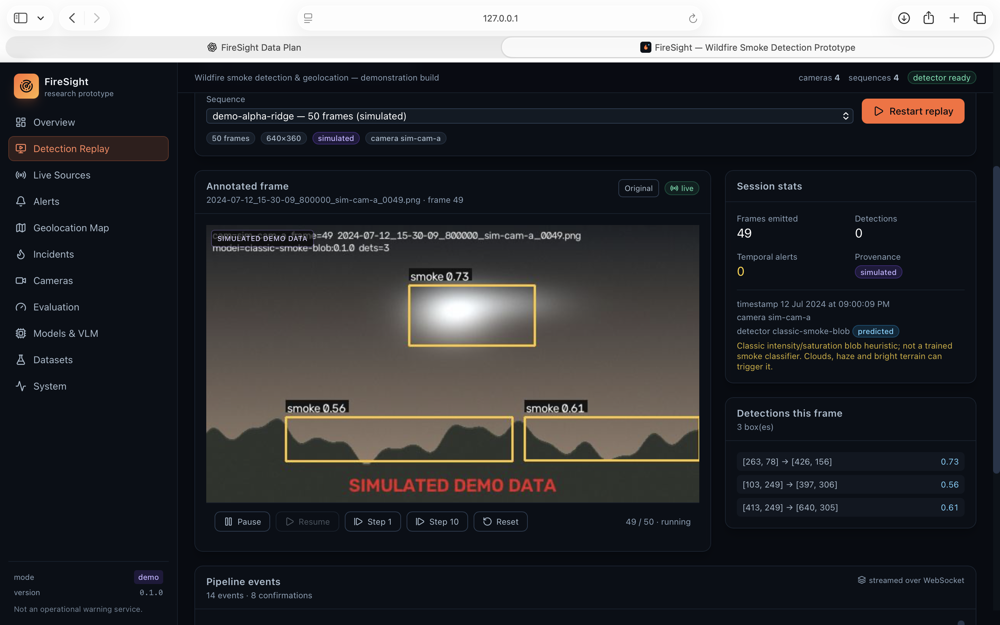
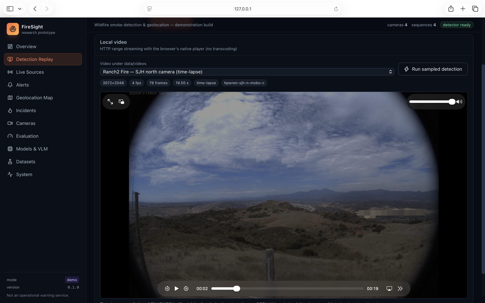
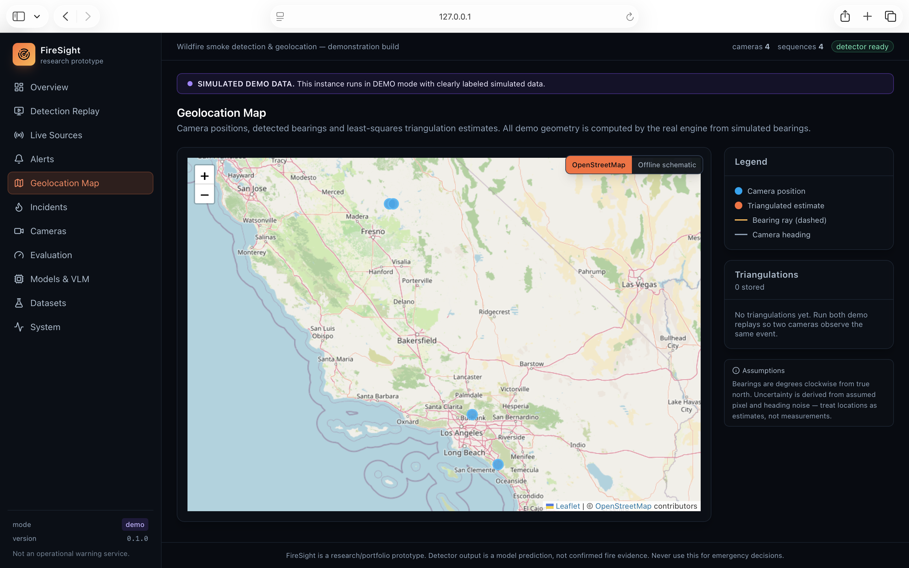
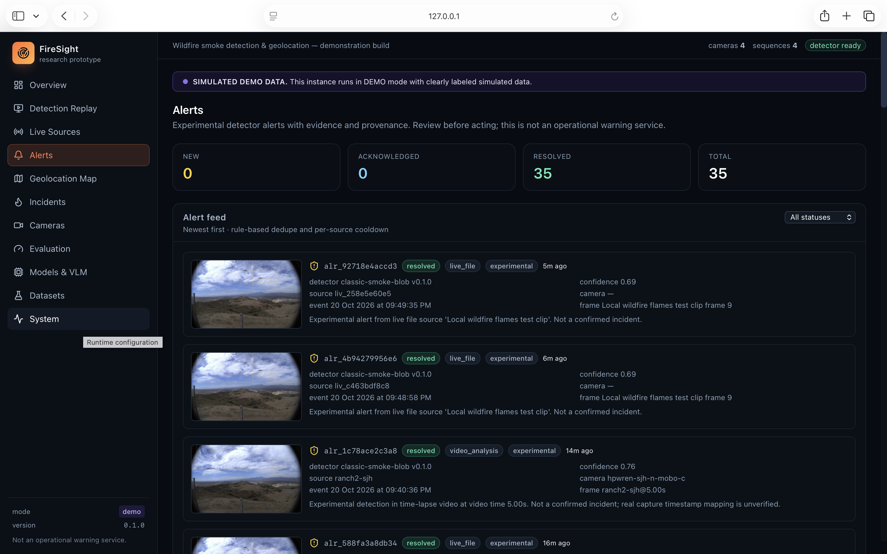

# FireSight

**Wildfire smoke detection and geolocation from fixed observation cameras — a
research / portfolio prototype.**

FireSight ingests fixed-camera image sequences, runs smoke detection, tracks
detections over time, converts confirmed detections into bearing observations,
associates them across cameras, and triangulates a geographic location with an
explicit uncertainty. Every record carries **provenance** (`real`, `predicted`,
`simulated`, `heuristic`, `manual`) so evidence is never silently mixed.

> **This is not an operational warning service.** It is a prototype for
> research and demonstration. It makes no claim of production readiness,
> measured accuracy on real fires, or emergency suitability. See
> [`docs/BUILD_STATUS.md`](docs/BUILD_STATUS.md) for what is and is not
> verified.

## Screenshots

> Captured in demo mode on the built-in synthetic scenario, not on real fires.

| | |
|---|---|
| **Overview**<br> | **Cameras**<br> |
| **Datasets**<br> | **Replay**<br> |
| **Detection**<br> | **Map**<br> |
| **Alerts**<br> | |

## Quick start (demo mode — no credentials, datasets, weights or GPU)

Requirements: [`uv`](https://docs.astral.sh/uv/) (Python ≥ 3.11) and Node ≥ 20.

```bash
# 1. Backend environment
cd backend && uv sync --all-extras   # or: uv sync  (core only, no YOLO)

# 2. Frontend dependencies
cd ../frontend && npm install

# 3. Launch both (API :8000 + frontend :5173); Ctrl-C stops everything
cd .. && ./scripts/dev.sh
```

Open <http://127.0.0.1:5173>. Demo mode ships a deterministic synthetic
scenario (two ridge cameras, a distracting cloud, a growing plume, a known
ground-truth source) so the entire pipeline runs with zero external inputs.

### Backend only

```bash
cd backend
uv run firesight serve                 # http://127.0.0.1:8000  (docs at /docs)
uv run firesight status                # runtime + detector + incident counts
uv run firesight replay demo-alpha-ridge --frames 45
uv run firesight evaluate              # demo-fixture evaluation
uv run firesight export-video demo-alpha-ridge --every 5
uv run firesight export-incident <incident_id>
```

## What it does

1. **Ingest** — stream frames from a directory (never loads a whole sequence
   into memory). Timestamp patterns are only accepted when verified.
2. **Detect** — `ClassicSmokeDetector`, a colour/texture blob heuristic
   (`provenance=predicted`; **not** a trained model). A YOLO adapter is
   available behind the optional `yolo` extra but is untrained here.
3. **Track** — confirm a detection as an event only after ≥3 hits, a
   persistence gate, and dedup.
4. **Bearing** — convert the confirmed pixel to a compass bearing using the
   camera's intrinsic/extrinsic calibration.
5. **Associate** — match bearings from ≥2 cameras into a candidate event.
6. **Triangulate** — least-squares ray intersection in a local ENU frame,
   returning an estimate plus uncertainty and ray-separation geometry.
7. **Incident** — `candidate → confirmed → reviewed / acknowledged / dismissed`,
   each transition recorded in a history table.
8. **Verify (optional)** — a vision-language model may annotate an incident;
   disabled unless fully configured via environment variables.

## Repository layout

```
backend/     Python package `firesight` (FastAPI API, CV, geometry, evaluation)
frontend/    React + TypeScript + Vite dashboard
scripts/     developer launcher (dev.sh)
docs/        architecture, datasets, training, calibration, evaluation, status
data/        local datasets / sequences (gitignored)
models/      model weights (gitignored)
```

## Real footage (extract → register → replay)

FireSight can replay **directories of still frames** and play **local MP4
videos** in the browser. It can also start a live source (RTSP or a looping
local test video) through the Live Sources page. Nothing is uploaded; files
must already exist under the backend data root.

Frame files must be `.jpg`, `.jpeg` or `.png`. To be treated as timed data, the
**filename** must start with one of these patterns (matching is by filename,
never guessed — an unmatched name yields `timestamp: null`):

| Pattern | Example |
| --- | --- |
| ISO-like | `2024-07-12_15-30-00_000000.png` (also `_` or `T` separators, `-` or `:` time separators, optional 1–6 digit microseconds) |
| Compact | `20240712_153000.png` |
| Optional event offset token | any of the above with `_t12.500s` appended before the extension |

Anything else (e.g. `frame_0001.png`) is stored with **no timestamp** and a
validation warning is returned; cross-camera time association then becomes
unreliable.

The directory must live **under the configured data root** (`data_root`, default
`backend/data/` when launched from `backend/`). Absolute paths, `..`
traversal, symlink escapes, missing directories and directories with no
supported images are rejected with an explicit error.

```bash
# 1. Extract frames from your own MP4 at 1 fps into the data root.
#    NOTE: the extracted frame index is NOT a capture time. If your camera
#    burned a real clock into the filename, keep it. Otherwise the frames are
#    registered with unknown timestamps and a warning is surfaced.
ROOT=backend/data/cctv/ridge-1
mkdir -p "$ROOT"
ffmpeg -i /path/to/recording.mp4 -vf fps=1 "$ROOT/2024-07-12_15-30-%02d.png"

# (Optional) If the recording's real timing can be recovered, encode it in the
# filename. This example assumes the first frame is 15:30:00 and 1 fps; adjust
# for your clock. This is synthetic timing unless it came from the camera.

# 2. Register the directory. Either use the UI (Datasets → Register footage
#    sequence: ID = cctv-ridge-1, directory = cctv/ridge-1) or the API:
curl -sS -X POST http://127.0.0.1:8000/api/v1/sequences \
  -H 'content-type: application/json' \
  -d '{"id":"cctv-ridge-1","root_path":"cctv/ridge-1","name":"Ridge camera 1","camera_id":"cam-a"}'

# 3. In the UI open Replay, pick the new sequence, press Start / Step.
```

For direct video playback, put an H.264 MP4 under `backend/data/videos/`
(optionally with a `manifest.json` label/camera entry) and open **Replay →
Local video**. The backend serves HTTP Range requests; the browser's native
player handles seeking. The bundled Ranch2 FIgLib clips are time-lapse
compilations, not continuous CCTV.

Sampled detection over a video is available from the same page. It writes
`summary.json`, `detections.csv`, a Markdown report, and bounded original /
annotated JPEGs under `backend/data/analysis/<video>/<run>/`. Results are
`experimental`, timestamp mapping is reported as `not_verified`, and boxes are
detector output — not ground truth.

### Live sources and alerts

- **Live Sources** accepts `rtsp://` / `rtsps://` URLs and local test videos
  under `data/videos/`. RTSP credentials are stripped from API responses and
  logs. A failed connection is reported as an error, never simulated success.
  RTSP ingestion has been smoke-tested end-to-end against a **local MediaMTX
  loopback server republishing the real Ranch2 MP4** (`rtsp://127.0.0.1:8554/
  firesight-test`): frames, preview, heuristic detections and a persisted alert
  were all observed. This exercises the transport, not a physical camera, and
  no credentials/TLS setup has been verified.
- **Alerts** are experimental detector events, persisted with detector name,
  provenance, evidence image, and a `new → acknowledged → resolved` lifecycle.
  Per-source cooldown/dedupe suppresses repeats. Use the Alerts page to review
  evidence. These are not confirmed incidents and not an operational warning
  service.

Real-data inference note: the default detector is a **heuristic smoke-blob
detector**, not a trained model — it flags bright/soft regions and can fire on
clouds, haze or bright terrain. It reports `provenance: predicted`. For a
trained detector see [`docs/MODEL_TRAINING.md`](docs/MODEL_TRAINING.md) and set
`detector.kind=yolo` with `model_path` in real mode.

## Documentation

- [`docs/ARCHITECTURE.md`](docs/ARCHITECTURE.md) — components, data flow, API.
- [`docs/DATASETS.md`](docs/DATASETS.md) — dataset layout and provenance rules.
- [`docs/MODEL_TRAINING.md`](docs/MODEL_TRAINING.md) — YOLO adapter and training.
- [`docs/CAMERA_CALIBRATION.md`](docs/CAMERA_CALIBRATION.md) — calibration model.
- [`docs/GEOLOCATION_AND_UNCERTAINTY.md`](docs/GEOLOCATION_AND_UNCERTAINTY.md) — geometry.
- [`docs/EVALUATION.md`](docs/EVALUATION.md) — metrics and what they mean.
- [`docs/DEMO_SCRIPT.md`](docs/DEMO_SCRIPT.md) — a guided walkthrough.
- [`docs/BUILD_STATUS.md`](docs/BUILD_STATUS.md) — honest build/verification log.
- [`AGENTS.md`](AGENTS.md) — project rules for contributors.

## Configuration

Copy `.env.example` to `.env` and edit. **Never commit a real `.env`.** Keys
are read from the environment only and are never echoed in API responses, the
UI, or logs. Backend settings use the `FIRESIGHT_*` prefix; VLM settings use
`VLM_*` (`VLM_BASE_URL`, `VLM_API_KEY`, `VLM_MODEL`).

## Testing

```bash
cd backend && uv run pytest -q && uv run ruff check .
cd frontend && npm run build && npm run lint
```

## License / status

Research prototype. Not an operational system. No warranty.
